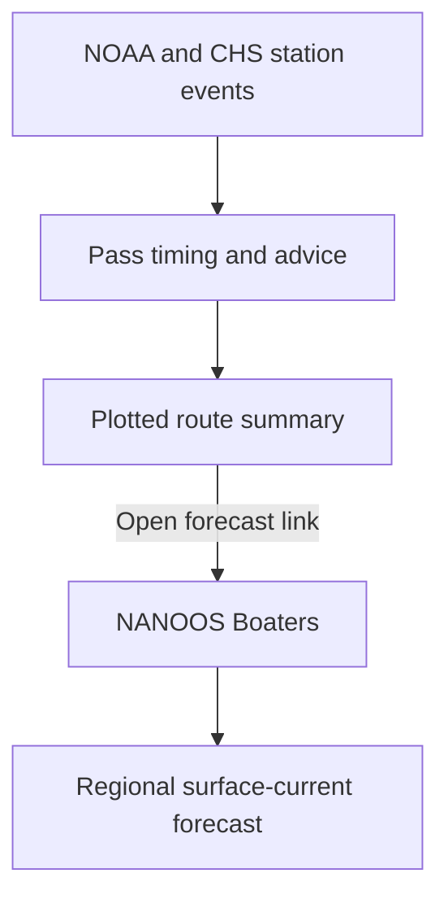

# 0003. NANOOS for regional surface-current context

**Date:** 2026-11-11  
**Status:** Accepted

## Context

The planner uses NOAA and Canadian Hydrographic Service station predictions
to estimate ebb, flood and slack at named passes. Sailors also need to see how
surface water is forecast to move between passes and on routes with no named
pass.

[NANOOS Boaters](https://nvs.nanoos.org/Boaters) offers a **Currents (Surface)**
layer under **Layers → Forecast Arrows**. In a browser check on November 11,
the layer initially showed no overlay for the selected time and displayed the
layer after choosing **Select Closest Data Point**. The map's selected time
matters. [UW LiveOcean](https://faculty.washington.edu/pmacc/LO/LiveOcean.html)
publishes experimental three-day forecasts, including a
[Puget Sound surface-current forecast](https://faculty.washington.edu/pmacc/LO/p5_PS_speed_top.html).

The [NANOOS ERDDAP archive](https://erddap.nanoos.org/erddap/index.html) exposes
machine-readable datasets. The current records inspected there included
location-specific [Makah Bay ADCP observations](https://erddap.nanoos.org/erddap/info/ocnms_mb42_lander_adcp/index.html).
The [UW data access page](https://faculty.washington.edu/pmacc/LO/data_access.html)
describes NetCDF extractions of a historical model run. This assessment did
not verify a machine-readable feed for the current forecast with the coverage,
timestamps, and resolution needed for the planner's route network.

## Options

| Option | Assessment |
| --- | --- |
| Keep station predictions alone | Covers pass timing and leaves currents between stations outside the planner. |
| Link to the NANOOS Boaters forecast map | Gives sailors access to regional surface-current context through a verified public product. |
| Sample model vectors along the route | Requires a verified live feed, coverage and freshness checks, and validation at narrow passes before any use in ETAs or transit advice. |

## Decision

Add one NANOOS Boaters link to each plotted route summary. Label it as a
regional forecast, provide the layer path, and open it in a new tab so the
plan stays visible. The link uses a fixed URL and the visitor opens it on
demand. Guide visitors to the closest data point and its timestamp when the
selected time has no overlay. The planner calculates pass timing from NOAA
and CHS station events.

## Consequences

- The regional forecast is accessible with or without a station match or
  successful station prediction.
- Forecast dates, coverage and availability are shown by NANOOS. The link
  also appears on routes planned beyond the forecast horizon.
- The planner sends no route coordinates, trip dates or pass IDs in the
  outbound link and makes no NANOOS requests while calculating a route.
