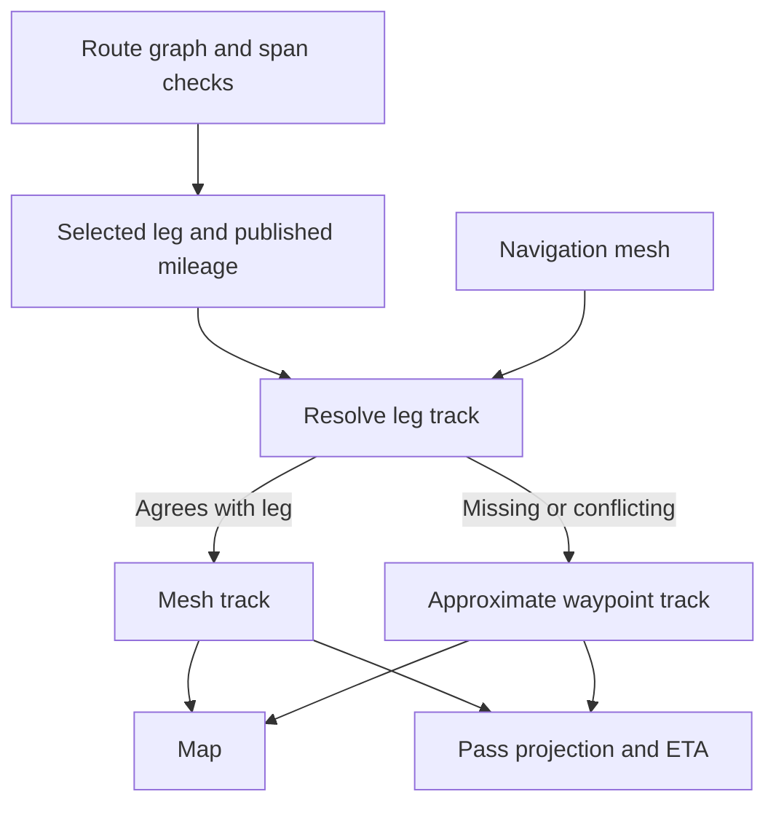

# 0004. Resolve a shared track for each planned leg

**Date:** 2026-11-11  
**Status:** Accepted

## Context

The route graph selects legs and filters them by known span clearance.
The map previously walked the mesh independently. Pass timing used a
waypoint line, so a displayed route could follow a different channel
from the one assumed by the timing or clearance checks.

## Decision

Keep published leg mileage and the graph's span classification as planning
inputs. Resolve each selected leg to a single display and timing track.
Accept a mesh path if it passes within 1 nautical mile of resolved via
points and named pass locations, and agrees with the leg's known spans.
For this consistency check, a mesh path within 0.25 nautical miles of a
known span counts as passing it. These tolerances are heuristics.

When the mesh is loading, unavailable, or disagrees with the leg, use
the curated waypoint line and label it approximate. The map draws
approximate legs with dashed lines. Project each pass onto the selected
track and scale its along-track distance within that leg to the published
mileage. Add the full mileage of preceding legs to calculate its ETA.

Keep an unreachable stop visible on the failed day. Subsequent days
remain unplanned at the last reachable stop.

## Consequences

- The map and timing use the same track. Loading the mesh can update both.
- The waypoint fallback can cross land. The fallback label and dashed line
  identify the uncertainty. Clearance remains an estimate based on the
  known spans and available route data.
- The app can adopt a future mesh pathfinder that enforces passage and
  span constraints during search. Today it checks the candidate after
  pathfinding and uses the waypoint fallback when they disagree.
