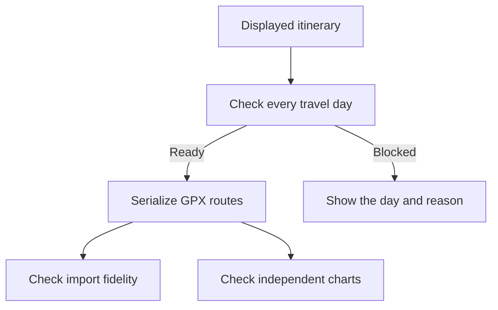

# 0005. Export the displayed itinerary as GPX 1.1 routes

Status: Accepted for development. Release gated by the [verification
record](../gpx-route-verification.md).

[Issue #53][issue-53] calls for a passage-planning file that users can inspect
in a charting app. [ADR 0004](0004-consistent-route-tracks.md) supplies the
leg coordinates shared by the map and pass timing.

## Decision

- Read the current itinerary snapshot, including each leg's resolved
  coordinates. Require every travel day to have a continuous, valid mesh
  track. Block the entire download and identify the first affected day if a
  destination is unreachable or geometry is pending, missing, approximate,
  invalid, or discontinuous.
- Emit one named [GPX 1.1](https://www.topografix.com/GPX/1/1/) route per day
  with ordered WGS84 route points. Preserve every vertex and collapse only the
  identical coordinates shared at a leg join. Name the start, each leg
  endpoint, and the finish. Preserve repeat visits and round-trip endpoints.
  The planner has no explicit layover state. A zero-leg day cannot produce a
  travel route.
- Keep eligibility, XML serialization, and the browser download separate. Use
  standard `rte` and `rtept` elements. Include the passage-planning
  description in the file and beside the button. Keep ETA, current, and
  clearance estimates in the planner.
- Use the server-side `ENABLE_GPX_EXPORT=1` switch for review and browser
  tests. Leave production off until the chart benchmarks and the reference
  OpenCPN import pass. Review another app on the intended hardware before
  naming it as supported.

Schema and vertex fidelity measure the file. Charted water, vessel clearance,
passage timing, and independently measured distance determine the release
gate.

[issue-53]: https://github.com/ivanoats/salish-nav-planner/issues/53
